## Sobre mim

- Trabalho como **Analista de QA**, com **Java**, **Selenium** e **PostgreSQL**
- Formado em **Análise e Desenvolvimento de Sistemas**
- Hoje meu foco é **full-stack**: **Spring Boot** no back-end, **React + TypeScript** no front e **Python** para dados e automação
- Transformo games em projeto: enciclopédia de Zelda, wiki de MU Online e um monitor desktop com visão computacional

## Tecnologias em foco

  

## Projetos em destaque

<table>
  <tr>
    <td width="33%" valign="top">
      <h3>Hyrule Explorer</h3>
      Enciclopédia, mapa interativo e tracker de progresso de <i>Zelda: Breath of the Wild</i>. API REST com 21 rotas e Swagger, mapa com 900 Korok Seeds e 136 shrines.
        
      
      
      
      
      
       repositório privado
    </td>
    <td width="33%" valign="top">
      <h3><a href="https://github.com/CarlosEduardo00/mu-explorer">MU Explorer</a></h3>
      Wiki e API estática de MU Online: scrapers em Python, validação com JSON Schema e site em Astro no Cloudflare Workers. 3.074 itens, 291 monstros e 23.759 drops.
        
      
      
      
      
       <a href="https://mu-explorer.buiu.workers.dev">ver online →</a>
    </td>
    <td width="33%" valign="top">
      <h3><a href="https://github.com/CarlosEduardo00/mu-sentinel">MU Sentinel</a></h3>
      App desktop para Windows que detecta morte, desconexão e travamento só pela imagem da tela (OpenCV + OCR) e avisa no Telegram. Atualização automática via GitHub Releases.
        
      
      
      
      
       <a href="https://github.com/CarlosEduardo00/mu-sentinel/releases/latest">baixar →</a>
    </td>
  </tr>
</table>

## Mexendo agora

<!-- RECENT:START -->
- **[mu-sentinel](https://github.com/CarlosEduardo00/mu-sentinel)** `Python` · Monitor de janelas do MU Online com alertas no Telegram e no Windows. Só lê a imagem da tela: não envia teclas, não lê memória e não mexe nos arquivos do jogo. (atualizado em 01 de nov. de 2026)
- **[mu-explorer](https://github.com/CarlosEduardo00/mu-explorer)** `Python` · Wiki feito por fã do jogo Mu online da Webzen (atualizado em 25 de out. de 2026)
<!-- RECENT:END -->

## Atividade

  

  

<!-- UPDATED:START -->
Seções automáticas atualizadas em 01/11/2026 por GitHub Actions.
<!-- UPDATED:END -->

